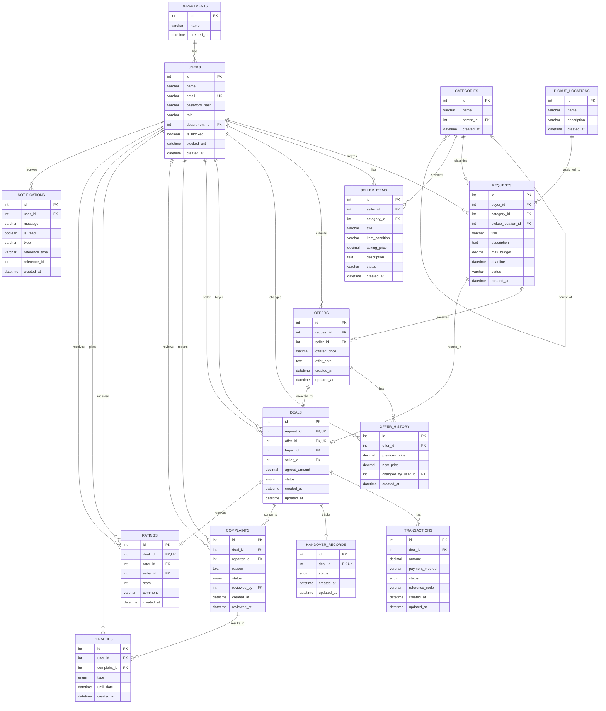

# Campus Plus — Final Entity Relationship Diagram

## 1. Overview

This document represents the final database structure of Campus Plus based on the consolidated MySQL schema.

The database uses MySQL with the InnoDB storage engine and contains 16 tables covering users, master data, requests, seller items, offers, deals, transactions, complaints, penalties, ratings, and notifications.

## 2. ER Diagram

## 3. Relationship Summary

| Relationship | Cardinality |
|---|---|
| Department – Users | One-to-Many |
| User – Requests | One-to-Many |
| User – Seller Items | One-to-Many |
| User – Offers | One-to-Many |
| User – Offer History | One-to-Many |
| User – Deals (Buyer) | One-to-Many |
| User – Deals (Seller) | One-to-Many |
| User – Complaints (Reporter) | One-to-Many |
| User – Complaints (Reviewer) | One-to-Many; reviewer is optional |
| User – Penalties | One-to-Many |
| User – Ratings (Rater) | One-to-Many |
| User – Ratings (Seller) | One-to-Many |
| User – Notifications | One-to-Many |
| Category – Requests | One-to-Many |
| Category – Seller Items | One-to-Many |
| Category – Category | Self-referencing |
| Pickup Location – Requests | One-to-Many |
| Request – Offers | One-to-Many |
| Offer – Offer History | One-to-Many |
| Request – Deal | One-to-Zero-or-One |
| Offer – Deal | One-to-Zero-or-One |
| Deal – Transactions | One-to-Many |
| Deal – Handover Record | One-to-Zero-or-One |
| Deal – Complaints | One-to-Many |
| Deal – Rating | One-to-Zero-or-One |
| Complaint – Penalties | One-to-Many |

## 4. Important Database Constraints

- User email addresses are unique.
- A seller can submit only one offer per request.
- Each deal references a unique request and a unique offer.
- Each deal can have at most one handover record.
- Each deal can have at most one rating.
- Rating stars must be between 1 and 5.
- Request budgets, seller asking prices, offer prices, and agreed deal amounts must be positive.
- Category hierarchy is maintained using `parent_id`.
- Foreign keys enforce referential integrity between related tables.
- The complaint reviewer can be optional if `reviewed_by` is nullable in the schema.

## 5. Source

The diagram is based on the SQL schema files in `database/schema/`:

- `01_master_data.sql`
- `02_users.sql`
- `03_requests.sql`
- `04_offers.sql`
- `05_deals.sql`
- `06_trust.sql`

**Note:** This is the technical database ER diagram. A separate Chen-notation diagram will be prepared for presentation purposes, using rectangles for entities, ellipses for attributes, diamonds for relationships, underlined primary keys, and clearly marked cardinalities.